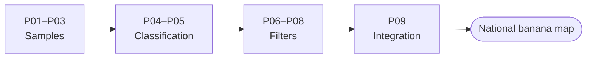

<p align="center">
  
  
</p>

# 🍌 MapBiomas Ecuador – Banana

Google Earth Engine scripts used by **MapBiomas Ecuador** ([EcoCiencia](https://www.ecociencia.org/)) to map **banana plantations** in Ecuador, year by year, from Landsat imagery. Banana is one of the **cross-cutting themes** of MapBiomas Ecuador: it was introduced as a **beta** in Collection 3 and continues in Collection 4.

## 🌱 What is a cross-cutting theme?

Some land-cover classes are hard to separate in the general land-cover map. For them, MapBiomas develops **cross-cutting themes**: specific methods that map **a single class of interest** independently from the general map. Other cross-cutting themes of MapBiomas Ecuador include glaciers, mining, urban infrastructure, flooded forests and mangroves.

During the **integration** of each collection, the result of each cross-cutting theme is incorporated into the final land-cover map.

Ecuador is one of the world's main banana producers, and banana plantations cover large areas of the coast. Mapping them as a separate theme makes it possible to follow where they are and how they change over time.

## 📚 Data sources

The reference information comes from several sources, mainly from the **Ministry of Agriculture and Livestock (MAG)** and other databases on banana cultivation areas and production zones. These data are used to build the training samples (regions of interest and known banana areas) and to check the results.

## 🗂️ Collections

| Collection | Folder | Status |
|---|---|---|
| Collection 3 | [`collection_3/`](collection_3/) | Published (banana in beta) |
| Collection 4 | [`collection_4/`](collection_4/) | In review – see its [README](collection_4/README.md) |

## 🔁 Method

Both collections follow the same nine steps. Steps P01 to P08 run **one banana region at a time**; P09 joins all regions into the national map.



| Step | Collection 3 | Collection 4 | What it does |
|---|---|---|---|
| P01 | `P01-ROIS-review.js` | `P01-review-rois.js` | Review of the banana regions of interest (ROIs) |
| P02 | `P02-stable-pixels.js` | `P02-stable-pixels.js` | Stable pixels used as reference for sampling |
| P03 | `P03-random-samples.js` | `P03-random-samples.js` | Stratified random training samples |
| P04 | `P04-classification.js` | `P04-classification.js` | Random Forest classification, year by year |
| P05 | `P05-stack-multiband.js` | `P05-stack-multiband.js` | One image with a band per year |
| P06 | `P06-pre-gapfill-filter.js` | `P06-pre-gapfill.js` | Completes the time series before filtering |
| P07 | `P07-spatial-filter.js` | `P07-spatial-filter.js` | Removes isolated pixels using their neighbors |
| P08 | `P08-gapfill-filter.js` | `P08-gapfill-filter.js` | Temporal gap fill of banana pixels |
| P09 | `P09-integration.js` | `P09-integration.js` | National banana map |

### Classes

| Class | Value |
|---|---|
| Banana | `74` |
| Not banana | `27` |

## 📂 Repository structure

```
ecuador-banana/
├── README.md               # This page
├── collection_3/           # Collection 3 (beta)
│   ├── P01-ROIS-review.js
│   ├── ...
│   └── P09-integration.js
└── collection_4/           # Collection 4
    ├── README.md           # Detailed description of each step, versions and pending items
    ├── P01-review-rois.js
    ├── ...
    └── P09-integration.js
```

## 🚀 How to use

1. Get a [Google Earth Engine](https://earthengine.google.com/) account and open the [Code Editor](https://code.earthengine.google.com/).
2. Choose the collection and open its scripts in order (P01 → P09), or paste them into new scripts.
3. Edit the parameters block at the top of each script and click **Run**.
4. For Collection 4, follow its [README](collection_4/README.md): it explains each step, the inputs and outputs, and the version numbers that connect the scripts.

## 🔗 Related

- MapBiomas Ecuador land-cover and land-use scripts (general map): `ecuador-lulc` repository.
- MapBiomas Ecuador platform: [ecuador.mapbiomas.org](https://ecuador.mapbiomas.org/).

## 👥 Authors

MapBiomas Ecuador team.

### Contact and more information

This initiative is part of the MapBiomas Network, coordinated by MapBiomas Ecuador. More information at [ecuador.mapbiomas.org](https://ecuador.mapbiomas.org/).
