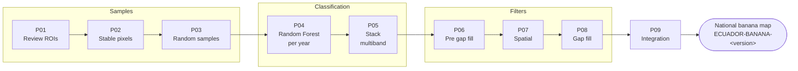

<p align="center">
  
  
</p>

# 🍌 Banana – Cross-cutting Theme (Collection 4)

Scripts used by **MapBiomas Ecuador – Collection 4** to map **banana plantations** (class `74`) year by year, from Landsat mosaics and Google Earth Engine. The result is a national map with two classes: banana (`74`) and not banana (`27`).


## 🌎 Overview

Banana is mapped separately from the general land-cover map, one **banana region** at a time (field `region` of the banana regions asset), and then integrated at national level.



| Classes | Value |
|---|---|
| Banana | `74` |
| Not banana | `27` |
| Farming (stable pixels only, P02) | `21` |

## 🔍 How each step works

### Samples

| Script | What it does |
|---|---|
| **P01 – Review ROIs** | Converts the banana ROI polygons of the region to a raster. The analyst can add (`inclusion`) or remove (`exclusion`) areas with polygons drawn in the Code Editor. |
| **P02 – Stable pixels** | Pixels with the same class in every year of Collection 3, grouped into 21 (from 14, farming), 74 (banana) and 27 (others). Pixels within **400 m** of the known banana areas 2018–2022 are removed (to avoid sampling unmapped banana as another class), and the reviewed ROIs of P01 are added on top. |
| **P03 – Random samples** | Stratified random points over the stable pixels: `samples.banana` points of class 74 and `samples.other` of class 27 (class 21 is not sampled). The same points are sampled on the mosaic of every year, plus terrain variables (elevation, slope, slope position, shade). |

### Classification

| Script | What it does |
|---|---|
| **P04 – Classification** | Random Forest per year with the variables of `featureSpace`. Patches smaller than 20 pixels take the class of their neighbors; every class other than 74 becomes 27. Optionally, banana is kept only where its probability is ≥ `minBananaProbability` (0.7). |
| **P05 – Stack multiband** | Joins the annual images into one image with a band `classification_<year>` per year (optionally with years from a previous stack). |

### Filters

| Script | What it does |
|---|---|
| **P06 – Pre gap fill** | Completes the time series: pixels with no value and years missing from the stack become 27. It does **not** copy classes from other years. |
| **P07 – Spatial filter** | Year by year, patches smaller than `minConnectedPixels` (10) take the most frequent class around them (5-pixel window). |
| **P08 – Gap fill** | Keeps only pixels classified as banana in at least `minBananaYears` (10) years, and fills their gaps in one direction (see below). Other pixels are masked and become 27 in P09. |

**P08 in detail** (`fillOrder: 't0tn_tnt0'`): class 27 is treated as a gap, so once a pixel becomes banana it stays banana until the end of the series.

```
Input:   27 27 74 27 74 74 27 74 ...   (≥ 10 banana years in the series)
Output:   -  - 74 74 74 74 74 74 ...   (- = masked → 27 in P09)
```

With `'tnt0_t0tn'` the fill goes backwards: banana from the start until its last banana year.

### Integration

| Script | What it does |
|---|---|
| **P09 – Integration** | Mosaics the final version of every region (`REGION_VERSIONS`). Banana is kept only within **200 m** (`bananaBuffer`) of the known banana areas 2018–2022; everything else inside Ecuador, including the pixels masked by P08, becomes 27. |

## 📂 Scripts

| Script | Input | Output (asset folder from `CollectionDirectories.js`) |
|---|---|---|
| [`P01-review-rois.js`](P01-review-rois.js) | Banana ROI polygons (`pathRoiBananaAct`) | `pathRoiStableBananaAct` · `ME-<COUNTRY>-<region>-<v>` |
| [`P02-stable-pixels.js`](P02-stable-pixels.js) | Output of P01, Collection 3 map | `pathStablePixelsBananaAct` · `ME-<COUNTRY>-<region>-<v>` |
| [`P03-random-samples.js`](P03-random-samples.js) | Output of P02, mosaics | `pathTrainingSamplesBananaAct` · `samples-<COUNTRY>-<region>-<year>-p03-<v>` |
| [`P04-classification.js`](P04-classification.js) | Samples of P03, mosaics | `pathPrelimiarClassificationBanana` · `BANANA-<COUNTRY>-<region>-<year>-<v>` |
| [`P05-stack-multiband.js`](P05-stack-multiband.js) | Annual images of P04 | `pathClassificationBananaAct` · `<COUNTRY>-<region>-<v>` |
| [`P06-pre-gapfill.js`](P06-pre-gapfill.js) | Output of P05 | `pathClassificationBananaFilterAct` · `<COUNTRY>-<region>-<v>` |
| [`P07-spatial-filter.js`](P07-spatial-filter.js) | Output of P06 | same folder as P06 |
| [`P08-gapfill-filter.js`](P08-gapfill-filter.js) | Output of P07 | same folder as P06 |
| [`P09-integration.js`](P09-integration.js) | Output of P08 of every region | `.../BANANA/STEP04-INTEGRATION/ECUADOR-BANANA-<v>` |


## 🚀 How to use

1. Sign in to the [GEE Code Editor](https://code.earthengine.google.com/).
2. Open the script or paste it into a new script.
3. Set `regionId` and the versions in `PARAMS`. Each parameter is documented in place.
4. Click **Run**, review the layers (mosaic, SAVI, classification, samples…) and start the export from the **Tasks** tab.
5. Run P01 → P08 for each banana region, then P09 once for the whole country.

**Drawn polygons.** P01, P02 and P04 accept polygons drawn in the Code Editor (inclusion / exclusion areas, extra samples). Draw them as **FeatureCollections** and pass their names in `PARAMS` (e.g. `polygons: { inclusion: inclusion, exclusion: exclusion }`).

## 🧰 Requirements

- A [Google Earth Engine](https://earthengine.google.com/) account.
- Input assets: annual mosaics (LULC step 1), banana regions and ROIs, known banana areas 2018–2022, MapBiomas Ecuador Collection 3 map, country boundary.
- Terrain data: ALOS World 3D (`JAXA/ALOS/AW3D30_V1_1`), MapBiomas RAISG slope position and shade mask.
- Optional: Planet NICFI basemaps (P02) require access to the NICFI program.

## 👥 Authors

MapBiomas Ecuador team (EcoCiencia)

### Contact and more information

This initiative is part of the MapBiomas Network, coordinated by MapBiomas Ecuador. More information at [ecuador.mapbiomas.org](https://ecuador.mapbiomas.org/).
